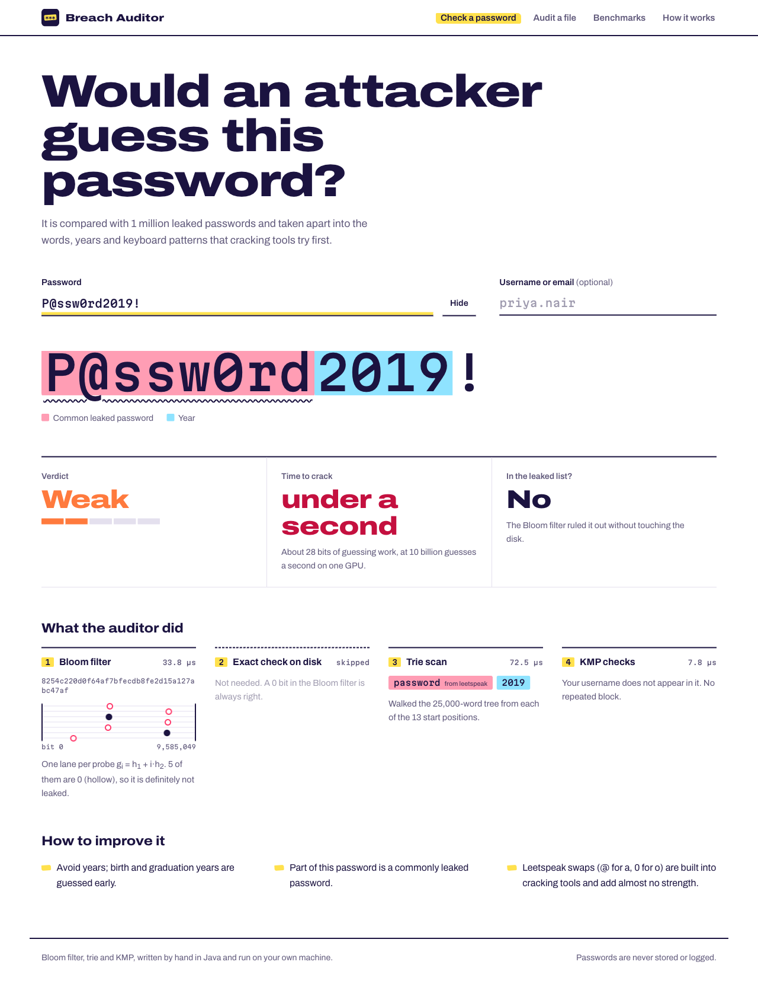
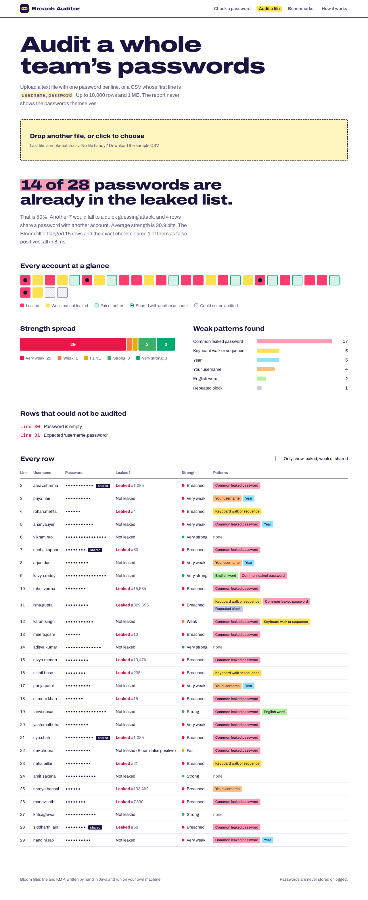
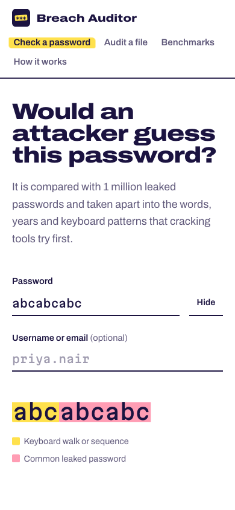

# Faultline

Checks passwords against 1 million real leaked passwords and explains what makes them guessable.
For a whole organisation, it simulates an attacker cracking every account smartest-guess-first, then
uses max-flow to name the fewest accounts to secure so a chosen system is out of reach.
It also redacts passwords and access tokens from text before it is shared.
It was built for the CIA 3 Advanced Algorithm project. The Java backend implements every
assessed algorithm by hand, and a React frontend calls it over REST.

| Algorithm | Syllabus unit | What it does here | Code |
|---|---|---|---|
| Bloom filter | Unit 6 (CO5, probabilistic) | In-memory "possibly leaked?" precheck; hits are confirmed by binary search on a sorted hash file | `algo/BloomFilter.java`, `store/SortedHashStore.java` |
| Trie | Unit 4 | Finds dictionary words, names, years, keyboard walks and common passwords inside a password (plus leetspeak) | `algo/Trie.java`, `algo/LeetNormalizer.java` |
| KMP | Unit 4 | Finds the username in the password; its prefix function detects repeated blocks | `algo/Kmp.java` |
| Binary heap | Unit 2 | Orders an attacker's guesses (base word × mangling rule) from most to least likely; a second Bloom filter skips repeated guesses | `algo/BinaryHeap.java`, `algo/GuessGenerator.java` |
| Aho–Corasick | Unit 4 | Scans shared text once for 30 credential cues and key formats so the secrets after them can be redacted | `algo/AhoCorasick.java`, `service/SecretRedactionService.java` |
| Max-flow / min-cut (Edmonds–Karp) | Unit 5 | Finds the fewest accounts to secure so no cracked account can reach a protected system | `algo/MaxFlow.java`, `service/OrgSimulationService.java` |



## Prerequisites
- JDK 21 or newer (tested on JDK 25). Maven is **not** needed because the repo ships the Maven wrapper (`mvnw`).
- Node.js 20 or newer and npm (tested on Node 26).

## Run it
Open two terminals from the repository root.

```bash
# 1. Backend on http://localhost:8080 (run from backend/ so ../data resolves)
cd backend
./mvnw spring-boot:run
```

```bash
# 2. Frontend on http://localhost:5173 (proxies /api to the backend)
cd frontend
npm install
npm run dev
```

Then open http://localhost:5173. The first backend start builds `data/cache/leaked-store.bin`
(24 MB, about 2 s); later starts reuse it.

### Configuration
Set these in `backend/src/main/resources/application.properties`, or override them with
`--pwaudit.data-dir=...`. No secrets are needed.

| Property | Default | Meaning |
|---|---|---|
| `pwaudit.data-dir` | `../data` | Folder holding `leaked-1M.txt` and `dictionary/` |
| `pwaudit.bloom-fpr` | `0.01` | Target Bloom filter false-positive rate |

## Tests and benchmarks
```bash
cd backend
./mvnw test        # 95 JUnit tests: at least 5 per algorithm, edge cases, API tests, full 1M no-false-negative check,
                   # min cut vs brute force on 150 random graphs
```
Benchmarks run from the **Benchmarks** page or with `curl -X POST localhost:8080/api/benchmark`
(about 30 s). The latest results and how to read them are in [`docs/benchmarks.md`](docs/benchmarks.md).
In summary:

- **Bloom filter:** the measured false-positive rate matches theory (0.98% against 1.00% at n = 1M), using 1.2 MB against about 85 MB for a HashSet.
- **Bloom + disk vs disk only:** 17× faster and 18× fewer disk reads.
- **Trie vs naive scan:** 42× to 698× faster as the dictionary grows, with identical matches.
- **KMP vs naive:** up to 324× faster on worst-case input.
- **Best-first vs brute-force guessing:** 288 of 1,000 synthetic accounts cracked in 5M guesses, against 0.
- **Repeat filter, Bloom vs HashSet:** about 50× less memory; 0.013% of new guesses wrongly skipped.
- **Aho–Corasick vs KMP per pattern:** the same 1,172 matches for 1,000 patterns in 100,000 characters, 3.0 ms against 222 ms (74×).
- **Edmonds–Karp vs Ford–Fulkerson:** the same min cut (1,104 accounts at 10,000 users, 113 ms); no speed-up on this graph shape, see the notes.

## API
| Method and path | Body | Returns |
|---|---|---|
| `POST /api/audit` | `{"password": "...", "username": "optional"}` | Breach status, leak rank, patterns, repetition, entropy, score 0–4, advice, per-stage timings, and the SHA-1 plus the 7 Bloom bit positions it probed (drawn live on the Check page) |
| `POST /api/audit/batch` | multipart `file` (.txt one per line, or CSV with header `username,password`; ≤ 10,000 rows, ≤ 1 MB) | Aggregates plus per-row results with masked passwords |
| `POST /api/org/simulate` | multipart `users` (CSV `username,role,department,password`; role and department optional), optional `access` (CSV `from,to`), `attacker` (`online`, `bcrypt`, `sha1`), `budgetSeconds`, `target`, `terms` | Cracking race (guesses tried, repeats skipped), per-account crack time and method, and the min cut: accounts to secure, time to reach the target before and after, and the attack-path subgraph |
| `GET /api/org/demo` | none | The Kestrel Labs demo files and settings |
| `POST /api/redact` | `{"text": "..."}` (≤ 1,000,000 characters) | The text with each secret replaced by a placeholder such as `[PASSWORD-1]`, plus per-finding line, column, kind, reason, masked preview and leak status (never the secret itself) |
| `GET /api/redact/sample` | none | The synthetic Kestrel Labs chat export used by the demo |
| `GET /api/stats` | none | Size and parameters of the loaded index |
| `POST /api/benchmark` | none | All eight experiments |

```bash
curl -s -X POST localhost:8080/api/audit -H 'Content-Type: application/json' \
  -d '{"password":"P@ssw0rd2019!"}'
# {"breachStatus":"NOT_PRESENT","patterns":[{"token":"password","category":"leaked","leet":true,...},
#  {"token":"2019","category":"year",...}],"entropyBits":28.2,"score":1,"verdict":"Weak",...}

curl -s -F file=@data/sample-batch.csv localhost:8080/api/audit/batch

curl -s -F users=@data/org-demo/users.csv -F access=@data/org-demo/access.csv \
  -F attacker=sha1 -F budgetSeconds=86400 -F "target=Payroll DB" -F "terms=kestrel,pune" \
  localhost:8080/api/org/simulate
# {"users":240,"race":{"guessesTried":5000000,"compromised":107,...},
#  "cut":{"target":"Payroll DB","accountsToFix":8,"compromisedWithAccess":65,"secondsToTargetBefore":7.0E-10,...}}
```
Invalid input returns HTTP 400 (413 for oversized uploads) as `{"error": "invalid_input", "message": "Password must not be empty."}`.

## How a password is audited
1. **Bloom filter:** hash the password with SHA-1 and check 7 bits. If any bit is 0, the password is definitely not leaked and the disk is never touched.
2. **Exact check:** on a Bloom hit, binary-search the sorted 24-byte records (hash + frequency rank). The result is either "confirmed, rank #N" or "Bloom false positive". For a live false-positive demo, try `bluefox136`.
3. **Trie scan** on the lower-cased password and on a leetspeak-normalised copy.
4. **KMP** for the username (and its parts, e.g. `priya.nair` → `priya`, `nair`) and for repeated blocks.
5. **Scoring:** a dynamic program picks the non-overlapping patterns with the lowest total guessing cost (log₂ of each dictionary's size), and brute-force bits cover the rest. A confirmed breach always scores 0.

## How an organisation is attacked
1. **Cracking race:** the uploaded passwords are hashed with SHA-1, and the attacker only sees the hashes. `GuessGenerator` produces guesses in decreasing probability: base words (leaked passwords by Zipf rank, organisation terms, names, English words, keyboard walks, years) × mangling rules (Capitalise, append digits, a year, `!`, leetspeak...). A binary max-heap walks the sorted base × rule grid, and a Bloom filter skips strings already tried. Each guess is hashed and matched; an account's crack time is its guess number ÷ the attacker's rate. The race stops at the time budget or 5M guesses. Accounts it does not reach are timed from their strength estimate, never earlier than the race ruled out.
2. **Attack graph:** accounts cracked within the budget are entry points. Access edges (`user → system`, `system → system`, `system → user` for a stored credential) say where the attacker can move next.
3. **Min cut:** each account becomes in → out with capacity 1 (secure it: reset, MFA, end sessions); systems and edges cannot be cut. Edmonds–Karp from a super-source joined to every entry account to the target gives the minimum number of accounts to secure, and the residual graph names them.
4. **Before and after:** the time to reach the target is the fastest crack time among accounts with a path to it, recomputed with the secured accounts removed.

The demo organisation is synthetic and seeded. Regenerate it with `java -cp backend/target/classes edu.atlas.pwaudit.service.OrgDemoGenerator data` after `./mvnw compile`.

## How shared text is redacted
1. **Cues:** an Aho–Corasick automaton over 30 lower-cased cues (`password`, `pwd`, `pin`, `otp`, `api key`, `token`, `secret`, ... and key prefixes `ghp_`, `AKIA`, `xoxb-`, `sk_live_`, ...) scans the text once. Cues must start at a word boundary.
2. **Values:** after a value cue, the token following a separator (`:`, `=`, `is`, `was`, `->`) on the same line is the secret, so "password for the VPN is X" finds X. With no separator, the next token counts only if it is password-shaped. Phrases such as "password reset" or "token expired" are left alone, as are values already redacted (`[REDACTED]`). A prefix cue takes the whole token when it is long enough to be a real key.
3. **Leaked words:** every other password-shaped token (letters plus digits or symbols, 6–64 characters, not an email or URL) goes through the Bloom filter, and only Bloom hits are confirmed by binary search on disk.
4. **Output:** overlaps keep the earlier, cue-based finding; the same secret always gets the same placeholder. Each finding is also scored, so a leaked credential is flagged as one to change, not just hide.

## Project layout
```
backend/   Spring Boot app: algo/ (Bloom, Trie, KMP, Aho–Corasick, heap, max-flow), store/, index/, service/, api/, plus tests
frontend/  React + Vite: pages/Check, Batch, Attack, Redact, Benchmarks, How it works
data/      leaked-1M.txt, dictionary/*.txt, sample-batch.csv, org-demo/ (cache/ is generated, git-ignored)
docs/      proposal.md, benchmarks.md, screenshots/
```

## Assumptions, limitations and failure cases
- A Bloom hit means "possibly leaked". Only the exact check reports a breach. False negatives are impossible, and a test verifies this for all 999,999 passwords.
- The strength score is a simplified guess-count estimate, not a guarantee. Unusual words outside the dictionaries are scored as random characters.
- The leaked list holds the top 1M passwords from public compilations, not every breach.
- Passwords are sent only to the local server and are never written to disk or logs. Batch results show masked values only.
- The attack simulation's guess model is a simplified, hand-weighted PCFG-style model, not a tuned cracker, so real attackers may be faster. It runs only on uploaded data, offline. Securing an account is modelled as cutting every path through it, and systems are treated as uncuttable.
- Simulation input errors: missing `username`/`password` header, more than 5,000 accounts or 50,000 access edges, bad `from,to` header, unknown target, bad attacker or budget, invalid organisation terms; duplicate usernames, empty fields, self-loops and malformed rows are skipped and reported per line.
- The redactor is rule-based: a secret with no cue that is not in the leaked list can slip through, and it does not detect names, emails or phone numbers. Empty or over-1,000,000-character text is rejected.
- Handled input errors: empty, whitespace-only, over 128 characters, control characters, over-long username, empty, oversized, non-UTF-8 or over-10,000-row files, malformed CSV rows (reported per line), and duplicates (reported as reuse).

## Data and attribution
- `data/leaked-1M.txt`: [SecLists](https://github.com/danielmiessler/SecLists) `Passwords/Common-Credentials/xato-net-10-million-passwords-1000000.txt` (MIT licence).
- `data/dictionary/names.txt`: SecLists `Usernames/Names/names.txt` (MIT licence).
- `data/dictionary/english.txt`: [google-10000-english](https://github.com/first20hours/google-10000-english) `google-10000-english-usa-no-swears.txt`.
- `data/dictionary/keyboard.txt` and `years.txt`: generated for this project.

## Screenshots
| Batch audit | Benchmarks | Mobile |
|---|---|---|
|  |  |  |
